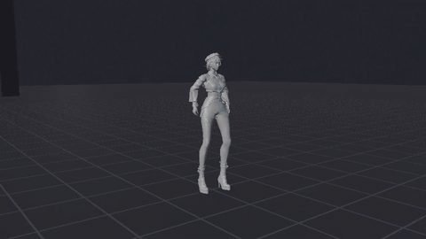

# Game Animation Tests

## Layout

```
assets/
  skeletal_meshes/   characters/, creatures/, props/
  skeletons/         skeleton assets, rigs/
  physics_assets/
  materials/ textures/
  animations/
    locomotion/ combat/ idle/ interaction/ facial/
    additive/ poses/
    montages/ blend_spaces/ anim_blueprints/
    mocap/           raw/, retargeted/
tests/
  animation/ skeletal_meshes/
docs/
tools/
  blender/           procedural animation + preview tooling (Blender 5.1 `bpy`)
```

## Animations

| Asset | Character | Notes |
|---|---|---|
| [`combat/A_ch02_SwordCombo`](docs/sword_combo.md) | `ch_02` | NieR-style sword combo, 60 fps, 6.3 s. The sword materialises at the start and dissolves at the end. Adds a `weapon_r` bone. |
| `idle/A_ch02_Idle_Loop` | `ch_02` | 4 s seamless idle; matches the combo's first/last pose. |


