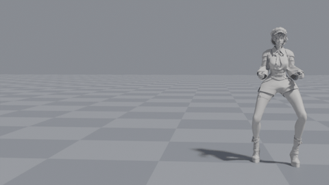
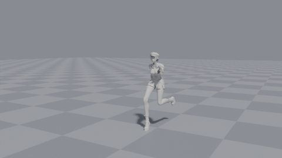

# Dodge animations

Four dodge clips for `ch_02` (Mixamo skeleton), fast and low in a NieR:Automata style.
FBX files live in `assets/animations/combat/dodge/`.

| Clip | Frames @30fps | Length | Travel | Notes |
|---|---|---|---|---|
| `A_Dodge_Stand_R` | 25 | 0.83 s | 1.9 m right | low sidestep dash with a short skid |
| `A_Dodge_Stand_L` | 25 | 0.83 s | 1.9 m left | mirror of `_R` |
| `A_Dodge_Sprint_R` | 23 | 0.77 s | 3.6 m fwd, 1.5 m right | sideways aerial with the legs in a wide straddle |
| `A_Dodge_Sprint_L` | 23 | 0.77 s | 3.6 m fwd, 1.5 m left | mirror of `_R` |




Contact sheets (every other frame): `previews/*_sheet.jpg`.

## Timing

Frame numbers are 0-based, as authored. Blender's FBX importer shows them shifted by one.

**Standing dodge.** Starts and ends in the same guard stance, so it blends with a combat idle.

| Frames | Phase |
|---|---|
| 0–2 | load: drop and lean away |
| 2–4 | burst off the far foot |
| 4–8 | low skim, near foot leading (the trailing foot leaves the ground at about frame 5) |
| 8 | lead foot lands |
| 8–12 | skid, trailing foot sweeps in |
| 12–22 | recover to guard |

Suggested gameplay windows: i-frames 2–9, cancel into attacks from frame 12, full recovery at 22.

**Sprint dodge.** Starts on a sprint stride with the dodge-side foot planted (right for `_R`, left for `_L`). It ends on a sprint stride with the opposite foot planted, so blend back into the sprint cycle at that phase.

| Frames | Phase |
|---|---|
| 0–3 | plant and load; the other leg kicks up and out |
| 3–5 | take-off |
| 5–13 | aerial rotation, inverted at frame 9, full leg split |
| 14 | the kicking leg's foot lands first |
| 16 | dodge-side foot lands wide (catch) |
| 16–22 | drive out and back into the sprint |

Suggested gameplay windows: i-frames 3–14, sprint resumes at 18.

## Root motion

Translation is on `mixamorig:Hips`, since the rig has no root bone. Use "root motion from hips" in your engine, or extract the Hips XY translation onto a root bone at import.

## Rebuilding

The clips are generated, not hand-keyed. To change one, edit its key poses in `scripts/build_dodge_anims.py` and re-run:

```
pip install bpy
python3 scripts/build_dodge_anims.py                         # writes the FBX files
python3 scripts/build_dodge_anims.py --preview docs/previews # also renders the GIFs and sheets
```

Only the `_R` clips are authored; the `_L` clips are mirrored from them. Planted feet use two-bone IK, and every frame is baked.
