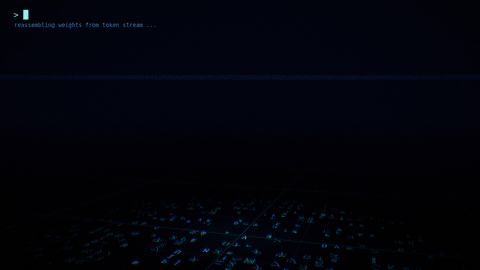

# LLM text VFX (Godot 4.5.1)

The character is an embodiment of a language model, so every effect is made of **text**:

- When the body disintegrates, it is *detokenized*.
- The dodge trails are streams of tokens.
- The orb form is the whole body compressed into one spinning context window.



Full-quality video: [`vfx/llm_vfx_showcase.mp4`](vfx/llm_vfx_showcase.mp4). Stills: `vfx/stills/`.

## Run it

Open the repo root in Godot 4.5.1 (`project.godot` lives at the root and uses the Compatibility renderer). Press F5. The showcase loops automatically. Any key switches to manual control:

| Key | Action |
|---|---|
| `1` / `2` | standing dodge right / left |
| `3` / `4` | sprint (aerial) dodge right / left |
| `Q` | collapse into the orb / unfold back into the body |
| arrows / WASD | fly the orb |
| `E` | disintegrate / reassemble |
| `R` | restart the scripted showcase |

To render the showcase to MP4 and GIF (works headless through `xvfb-run`):

```
GODOT=/path/to/Godot_v4.5.1-stable_linux.x86_64 vfx/tools/render_showcase.sh 1280x720
```

User args after `--`: `--showcase-once` quits at the end of the timeline. `--start=7.4` jumps to a beat (from that point on).

## What's on screen

### 1. Disintegration — `vfx/shaders/llm_character.gdshader`

This shader replaces the imported materials on `c002_body` and `c002_head`. The rest-pose vertex positions are baked into `CUSTOM0` at load time, so text and dissolve cells stay stuck to the skin while the skeleton animates.

- **Dissolve field.** The field is either a linear sweep (`dissolve_axis`) or a radial collapse toward `dissolve_origin`. It is mixed with per-voxel hash noise.
- **Glyph band.** Just ahead of the erase front, the skin darkens to terminal black and is rewritten as glowing glyphs. They re-sample about 9×/s, like a model still choosing a token. About 3% of tokens light up amber as "attention" highlights.
- **Letter cutout.** Closer to the front, everything except the glyph strokes is discarded, so the body literally comes apart as characters. Word gaps open first.
- **Burning front.** The last glyphs flare white-hot before they detach.
- **Interior.** Back faces render as a dark terminal full of text, so the holes show what the body is made of.
- **Data skin.** Faint lines of scrolling text, revealed by fresnel and by a periodic horizontal *inference scan*.
- **Glitch.** During dashes, horizontal slices of the body tear sideways and flash token colours.

The particles are synchronized with the shader. `vfx/scripts/glyph_hash.gd` is a bit-exact CPU mirror of the shader's PCG hash and dissolve field. The controller pre-samples surface vertices, sorts them by field value, and CPU-skins each one at the moment the shader erases its voxel. The glyph particle spawns exactly where the text vanished. Reassembly runs the same schedule backwards: each glyph is launched so it lands at the moment its voxel is written back.

### 2. Dodge / dash — `llm_character_vfx.gd` + `llm_afterimage.gdshader` + `token_ribbon.gdshader`

The dash uses the four dodge clips from `assets/animations/combat/dodge/` (see [dodge_animations.md](dodge_animations.md)). The effects run only inside each clip's i-frame window:

- **Text afterimages.** Every 65 ms the current pose is frozen into a copy of the skeleton, drawn only as glyph rows and a fresnel outline. As it ages, its rows shear apart along the dash direction, and it is garbage-collected voxel by voxel. The hue cycles cyan → violet across successive ghosts.
- **Token ribbons.** Billboard trails on the hands, feet and head stream text along their length. The text is anchored in world space, so it doesn't slide. The glyphs stay upright whichever way the trail moves.
- **Wake sheet.** A body-height vertical sheet of 14 text lines is left behind the hips.
- **Glyph shedding.** Glyphs peel off random surface points, at a rate scaled by speed.
- **Impact frame.** On top of the above: chromatic split, scan tearing, camera shake and a floor shockwave ring.

The hips root motion is folded back into the character node when each clip ends.

### 3. Orb form — `llm_orb.gd` + `llm_orb.gdshader`

**Collapse.** The body dissolves radially from the extremities toward the chest. Every detached glyph spirals into the orb (`GlyphSwarm.Mode.ATTRACT`) while the orb assembles, row by row, out from its equator.

**Orb.** The orb has several layers:
- a text globe whose latitude rows spin in alternating directions
- a scanning meridian
- a churning white core with a heartbeat pulse
- three tilted rings of streaming tokens
- a cloud of orbiting glyphs
- a text-ribbon trail
- a cyan point light that lights the floor

Speed drives `charge`, which spins the text faster and triggers the impact post-effect.

**Unfold.** Glyphs fly out of the orb and are written back into the body from the chest outward.

### 4. Supporting pieces

| File | Role |
|---|---|
| `vfx/shaders/glyph_common.gdshaderinc` | hashing, glyph atlas sampling (seam-free mips via `textureGrad`), text-line layout, palette |
| `vfx/shaders/glyph_particle.gdshader` | billboard glyph sprites for the swarm |
| `vfx/scripts/glyph_swarm.gd` | CPU particle sim (drift / attract / converge / orbit) rendered through one `MultiMesh` |
| `vfx/scripts/token_ribbon_trail.gd` | ribbon builder (`ImmediateMesh`), camera-facing or vertical sheet |
| `vfx/shaders/data_floor.gdshader` | dark glass floor: grid, faint embedding-space text, glow pool, shockwave rings |
| `vfx/shaders/post_glitch.gdshader` | post pass on the `SubViewportContainer`: chromatic split, tearing, scanlines, vignette, grain |
| `vfx/textures/glyph_atlas.png` | 16×16 glyph atlas (ASCII, math, Greek, box drawing, katakana, CJK). R = glyph, G = halo. Rebuild with `python3 vfx/tools/make_glyph_atlas.py` |
| `vfx/scripts/vfx_showcase.gd` | stage, camera, timeline, captions and interactive controls |

## Using it in a game

```gdscript
var ch := LlmCharacterVfx.new()
ch.swarm = $GlyphSwarm          # one shared GlyphSwarm in the level
ch.fx_root = $Fx                # where trails and afterimages are parented
add_child(ch)

ch.dodge("sprint_r")            # dash with the full trail stack
ch.disintegrate(2.0)            # sweep upward into drifting text
ch.reassemble(1.8)              # glyphs fly in and rewrite the body
ch.collapse_to_orb($Orb)        # then tween $Orb.form 0 -> 1
ch.unfold_from_orb($Orb)        # and tween $Orb.form 1 -> 0
```

The palette lives in `llm_palette()` in `glyph_common.gdshaderinc` (indigo → violet → electric cyan → white-hot, with amber attention tokens). Change it once and every layer follows.
